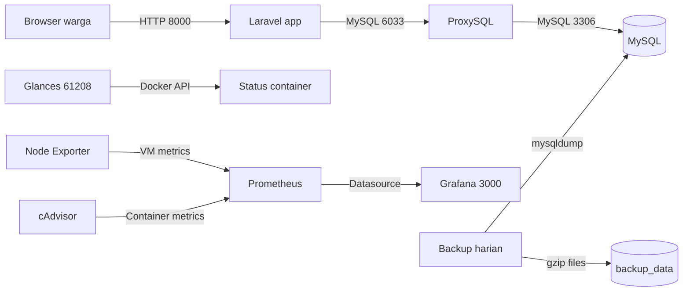

# Deployment Cloud Computing

## Arsitektur

Semua layanan berjalan dengan Docker Compose di satu VM Ubuntu. Port aplikasi, Grafana, dan Glances dapat diakses melalui IP VM. MySQL, ProxySQL, Prometheus, dan exporter hanya terhubung di jaringan internal Docker.

## Scaling yang dipilih: vertical

Alokasikan **4 vCPU dan 4 GB RAM** ke VM Ubuntu melalui VMware Workstation saat VM dalam keadaan mati. Jalankan Docker Engine dan Docker Compose di dalam Ubuntu. Pendekatan ini menambah CPU dan memori untuk satu VM, tanpa load balancer atau VM aplikasi tambahan.

## Deploy setelah clone

Ikuti langkah di [README.md](README.md): salin `.env.example` menjadi `.env`, buat `APP_KEY`, jalankan Compose, lalu jalankan migrasi dan seeder satu kali.

Untuk membuka layanan dari komputer host, cari IP Ubuntu dengan `hostname -I`. Pastikan adapter VMware memakai bridged atau host-only sesuai jaringan yang dipakai dan firewall mengizinkan port 8000, 3000, serta 61208.

## Monitoring dan backup

Glances menampilkan CPU, memori, filesystem, proses, serta status container melalui port 61208. Prometheus mengumpulkan metrik Node Exporter dan cAdvisor setiap 15 detik; Grafana menyediakannya melalui dashboard yang otomatis dipasang. Kata sandi Grafana dibuat saat menyiapkan `.env` dan tidak disimpan di Git. Backup awal dibuat saat Compose mulai; crontab VM menjalankan backup harian pukul 02.00. File gzip disimpan di volume Docker `backup_data` selama tujuh hari. Prosedur pemeriksaan dan pemulihan ada di [BACKUP_AND_RESTORE.md](BACKUP_AND_RESTORE.md).
